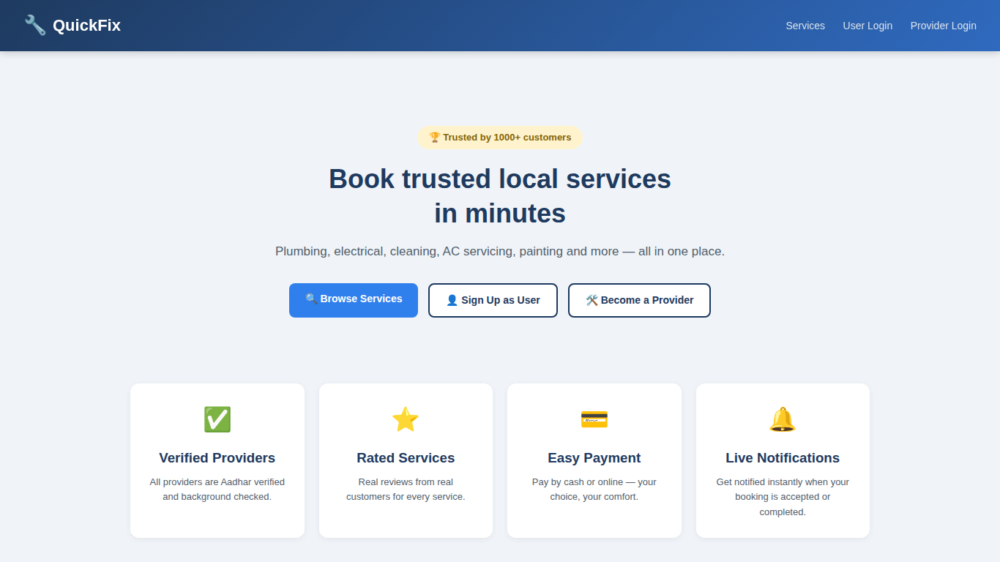
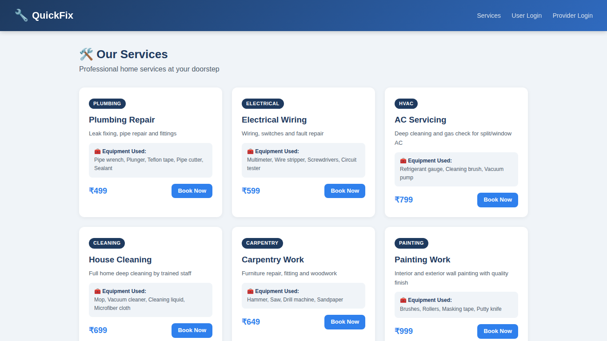
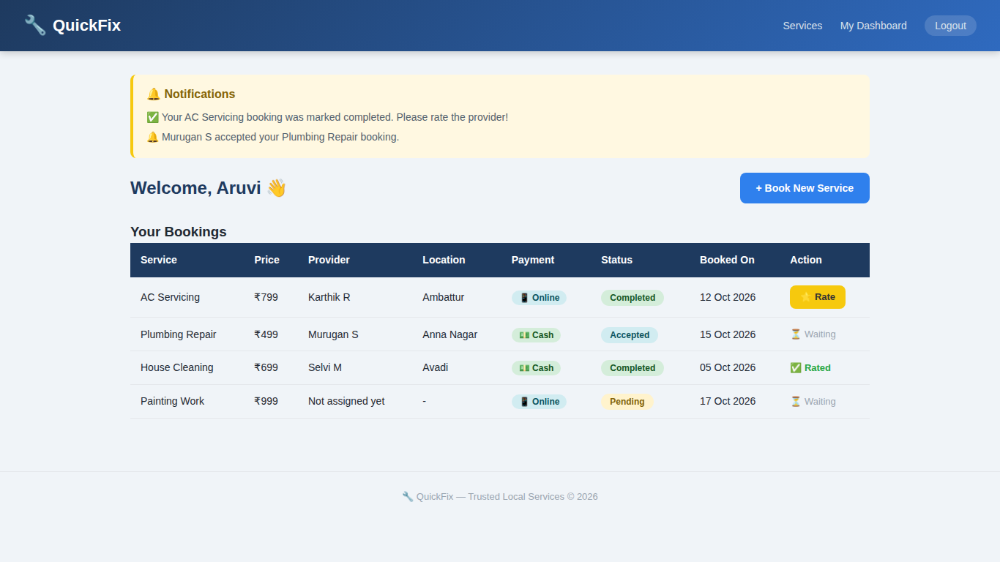
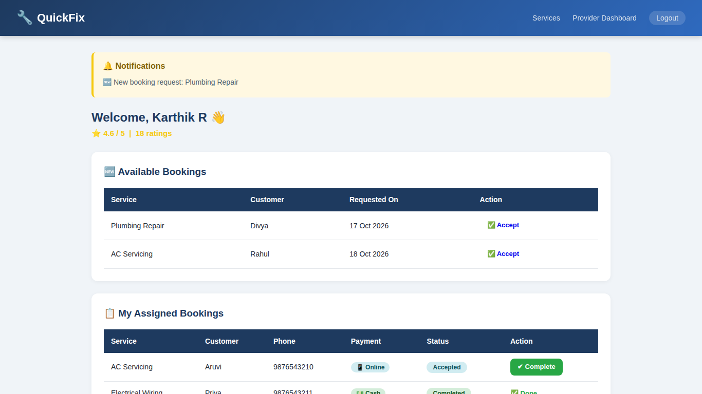
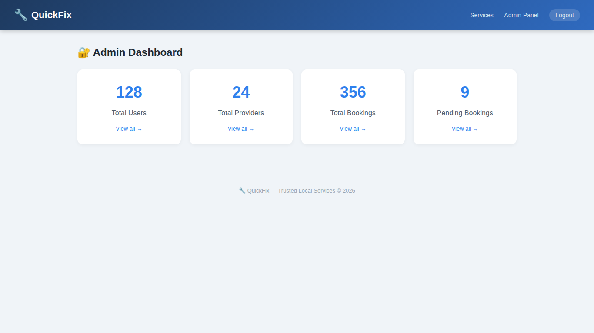

# 🔧 QuickFix – Home Services Booking Platform

A Flask + MySQL web app where users book home services (plumbing, electrical, AC servicing, cleaning, carpentry, painting) and verified providers accept and complete jobs.

## ✨ Features
- User & provider registration/login (hashed passwords)
- Browse services and book with payment method (cash/online)
- Provider dashboard: accept / complete bookings
- Ratings & reviews after job completion
- In-app notifications for users and providers
- Admin panel: users, providers, bookings
## 📸 Screenshots

| Home | Services |
|---|---|
|  |  |

| User Dashboard | Provider Dashboard |
|---|---|
|  |  |

### Admin Dashboard


*(Screenshots show sample demo data.)*
## 🛠 Tech Stack
Python · Flask · MySQL · Jinja2 · HTML/CSS

## 🚀 Setup
```bash
git clone https://github.com/<your-username>/quickfix.git
cd quickfix
python -m venv venv
venv\Scripts\activate        # Windows
# source venv/bin/activate   # Mac/Linux
pip install -r requirements.txt
cp .env.example .env         # then edit .env with your MySQL password
```

### Database
```sql
CREATE DATABASE quickfix_db;
```
Run `schema.sql`, then `alter_schema.sql` in MySQL.

### Run
```bash
python app.py
```
Open http://127.0.0.1:5000

## 📁 Structure
```
app.py            # routes & logic
config.py         # env-based config
templates/        # Jinja2 pages
static/           # CSS & uploads
alter_schema.sql  # schema updates + seed services
```

## 📌 Note
College project. Admin credentials come from `.env` – change them before any deployment.
